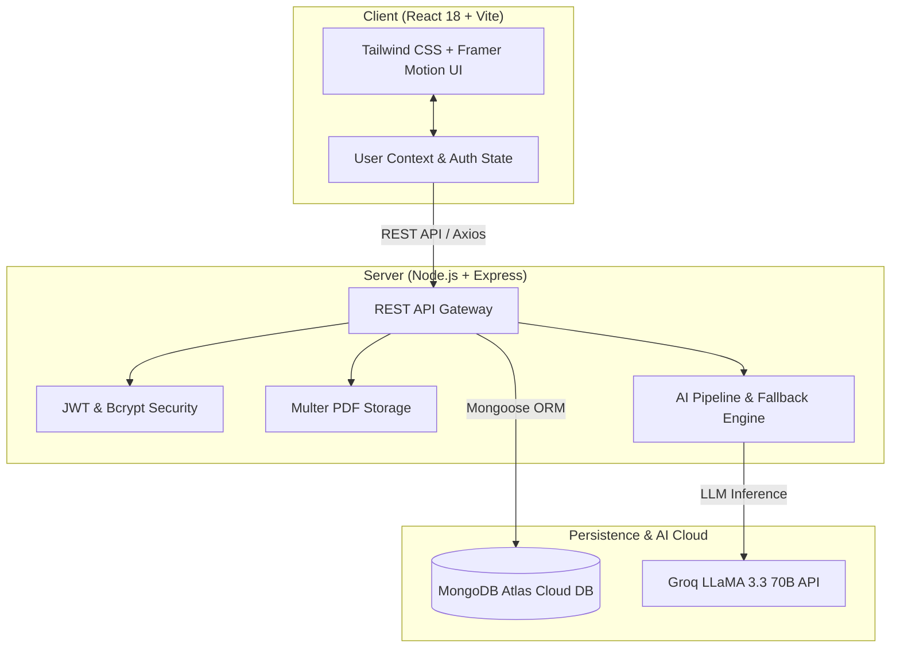

# 🔬 Paprism — AI-Powered Research Paper Simplifier

<div align="center">

> ### *"Read. Refract. Reveal."*
> **Transforming dense academic papers into digestible insights, interactive flashcards, self-tests, and conversational Q&A.**

[](https://reactjs.org/)
[](https://vitejs.dev/)
[](https://nodejs.org/)
[](https://www.mongodb.com/)
[](https://groq.com/)

[](https://paprism-research-paper-analyzer.vercel.app/)
[](https://paprism-research-paper-analyzer-backend.onrender.com/)

🚀 **Live App**: [https://paprism-research-paper-analyzer.vercel.app](https://paprism-research-paper-analyzer.vercel.app/)  
📡 **Live API**: [https://paprism-research-paper-analyzer-backend.onrender.com](https://paprism-research-paper-analyzer-backend.onrender.com/)

[Explore Features](#-what-is-paprism) • [How It Works](#-how-it-works-in-3-steps) • [Quick Start](#-quick-start-run-locally-in-5-minutes) • [Tech Architecture](#-under-the-hood-technical-architecture)

</div>

---

## 💡 What is Paprism?

Just like an optical prism splits a single beam of white light into a vibrant spectrum of colors, **Paprism** takes a complex, 20-page academic PDF and breaks it down into **customized learning layers tailored to your expertise level**.

Whether you are a **first-year student**, a **curious enthusiast**, or an **experienced researcher**, Paprism gives you the right depth of understanding without getting lost in mathematical walls and dense academic jargon.

### 🥊 The Problem vs. The Paprism Solution

| The Traditional Way ❌ | The Paprism Way ✨ |
| :--- | :--- |
| **Intimidating Jargon**: Dense 30-page PDFs with cryptic mathematical notation. | **Multi-Tier Summaries**: Read with simple real-world analogies or technical depth. |
| **Passive Reading**: Skimming through text and forgetting 90% the next day. | **Active Recall**: Auto-generated 3D flip flashcards and quizzes test what you learned. |
| **Hallucinated AI Answers**: Generic chatbots that give unverifiable claims. | **Grounded RAG Assistant**: Every answer includes clickable citations to the exact page. |
| **Disconnected Tools**: Switching between PDF readers, ChatGPT, and flashcard apps. | **All-In-One Workspace**: Upload, read, chat, test, and track in one dashboard. |

---

## 🎯 Who is this for?

- 🎓 **Undergraduate & Graduate Students**: Cut reading time in half for assignments, literature reviews, and thesis research.
- 🔬 **Researchers & Professors**: Rapidly screen new papers and extract key methodologies without reading end-to-end.
- 💡 **Curious Learners & Tech Enthusiasts**: Understand breakthroughs in AI, biology, and physics without a Ph.D.

---

## 🌈 Key Features: The 4 "Refraction" Modes

### 1. 📑 Multi-Level Summaries
Read according to your background with a single click:
- **👶 Beginner Mode**: Uses everyday analogies (e.g., explaining Self-Attention like "taking a wide-angle photograph instead of looking through a keyhole").
- **🎓 Intermediate Mode**: Explains architecture, motivations, and trade-offs in plain technical English.
- **🔬 Technical Mode**: Preserves formal mathematical formulation, hyperparameters, and experimental benchmarks.
- **01–04 Executive Breakdown**: Instant breakdown of *Problem* &rarr; *Approach* &rarr; *Key Findings* &rarr; *Limitations*.

### 2. 💬 Grounded AI Research Assistant (RAG)
Chat directly with the uploaded document.
- **Citation-Backed**: The AI tags its responses with precise source references (e.g., `Sources: Page 3, Section 3.2`).
- **No Hallucinations**: Constrained strictly to the contents of the document.

### 3. 🗂️ Interactive 3D Flip Flashcards
- Automatically extracts key concepts, acronyms, and formulas into 3D flip cards.
- Perfect for quick revision before exams or lab meetings.

### 4. 📝 Active Comprehension Quizzes
- Dynamic multiple-choice questions automatically synthesized from the paper.
- Instant scoring with step-by-step explanations of why each answer is right or wrong.

---

## 🚀 How It Works (In 3 Simple Steps)

```text
┌─────────────────┐       ┌────────────────────────┐       ┌─────────────────────────┐
│  1. UPLOAD PDF  │ ───►  │  2. AI REFRACTION      │ ───►  │  3. INTERACTIVE STUDY   │
│  Drag & drop    │       │  Extracts structure,   │       │  Read analogies, chat,  │
│  research paper │       │  summaries, Q&As & MCQs│       │  flip cards, take quiz  │
└─────────────────┘       └────────────────────────┘       └─────────────────────────┘
```

1. **Upload**: Drop any academic PDF (up to 25MB) into the upload zone.
2. **Refract**: The AI extracts the sections, figures out the core problem, and generates summaries and quiz material.
3. **Master**: Switch between summary levels, ask questions in chat, test yourself with quizzes, and bookmark papers in your library.

---

## 🛠️ Under the Hood (Technical Architecture)

For developers, evaluators, and engineers looking at the underlying stack:



### Tech Stack Highlights

| Component | Technology | Why We Used It |
| :--- | :--- | :--- |
| **Frontend** | React 18 + Vite | Lightning-fast HMR and modular component structure. |
| **Styling** | Tailwind CSS | Clean, modern academic editorial design system. |
| **Animations** | Framer Motion + Canvas | Smooth 3D card flips and fluid cursor interactions. |
| **Backend** | Node.js + Express.js | Robust, lightweight asynchronous API gateway. |
| **Database** | MongoDB Atlas | Flexible JSON schema for storing structured paper data. |
| **Authentication** | JWT + bcrypt | Secure password hashing and stateless token auth. |
| **AI Inference** | Groq (LLaMA-3.3-70B) | Sub-second ultra-fast LLM responses for real-time summaries and chat. |

---

## 📁 Project Structure

```text
Mini Project/
├── 📄 README.md                   # You are here!
├── 🔒 .gitignore                  # Keeps sensitive keys and node_modules safe
│
├── 📂 backend/                    # Express + MongoDB API Server
│   ├── config/db.js               # MongoDB Atlas connection
│   ├── controllers/               # Route logic (Auth, Papers, AI Chat)
│   ├── middleware/                # JWT verification & PDF file filter
│   ├── models/                    # Database schemas (User.js, Paper.js)
│   ├── routes/                    # API endpoints (/api/auth, /api/papers, /api/ai)
│   ├── scripts/seed.js            # Pre-loads sample papers & demo user
│   ├── services/aiService.js      # Groq AI integration & smart fallbacks
│   ├── uploads/                   # PDF file storage
│   ├── .env.example               # Backend environment template
│   └── server.js                  # Entry point
│
└── 📂 Frontend/                   # React 18 User Interface
    ├── src/
    │   ├── components/            # UI pieces (Navbar, Sidebar, Flashcards, Quiz)
    │   │   └── creative/          # Creative visual effects (DomeGallery, SplashCursor)
    │   ├── pages/                 # Full pages (Landing, Dashboard, Workspace, Quiz)
    │   ├── context/               # Global state (UserContext)
    │   ├── services/              # API caller (Axios)
    │   └── App.jsx                # Router & main view
    ├── .env.example               # Frontend environment template
    └── package.json
```

---

## ⚡ Quick Start (Run Locally in 5 Minutes)

### Prerequisites
Make sure you have installed:
- [Node.js](https://nodejs.org/) (Version 18 or higher)
- [MongoDB Atlas Account](https://www.mongodb.com/) (Free tier)
- [Groq Cloud API Key](https://console.groq.com/) (Free)

---

### Step 1: Configure Backend

1. Open a terminal and navigate to `backend`:
   ```bash
   cd backend
   npm install
   ```

2. Create your `.env` file:
   ```bash
   cp .env.example .env
   ```

3. Open `backend/.env` and insert your credentials:
   ```env
   PORT=5000
   MONGO_URI=mongodb+srv://<username>:<password>@cluster0.mongodb.net/paprism?appName=Cluster0
   JWT_SECRET=any_super_secret_string_12345
   CORS_ORIGIN=http://localhost:5173
   GROQ_API_KEY=gsk_your_groq_api_key_here
   ```
   > 💡 *Note: If your MongoDB password has special characters like `%` or `@`, ensure they are URL-encoded (e.g. `%` becomes `%25`).*

---

### Step 2: Seed Sample Papers *(Recommended)*

Populate your database with seminal papers (*"Attention Is All You Need"*, *ResNet*, *BERT*) and a test account:

```bash
npm run seed
```

Start the backend:
```bash
npm run dev
```
Backend runs at: **`http://localhost:5000`**

---

### Step 3: Start the Frontend

1. Open a **second terminal** and navigate to `Frontend`:
   ```bash
   cd Frontend
   npm install
   ```

2. Create your `.env` file:
   ```bash
   cp .env.example .env
   ```
   *(Ensure it contains `VITE_API_URL=http://localhost:5000/api`)*

3. Start the dev server:
   ```bash
   npm run dev
   ```

4. Open your browser at **`http://localhost:5173`**! 🎉

---

## 🔑 Demo Login

If you ran `npm run seed`, you can log in immediately with:

| User | Credentials |
| :--- | :--- |
| **Email** | `elena.vance@university.edu` |
| **Password** | `Password123!` |

*(Or register any new account on the Signup screen)*.

---

## 📡 Key API Endpoints

| Method | Route | Description |
| :--- | :--- | :--- |
| `POST` | `/api/auth/register` | Create a new user account |
| `POST` | `/api/auth/login` | Log in and receive JWT token |
| `GET` | `/api/papers` | Get user's saved research papers |
| `GET` | `/api/papers/:id` | Get single paper with all summaries, flashcards, & quizzes |
| `POST` | `/api/papers/upload` | Upload PDF and start AI analysis pipeline |
| `POST` | `/api/ai/chat` | Ask grounded questions with page citations |

---

## 🎓 Academic Project Information

- **Domain**: Artificial Intelligence, Natural Language Processing, Retrieval-Augmented Generation (RAG)
- **Project Type**: B.Tech 3rd Year Mini Project (2026)
- **License**: Academic and Educational Use
